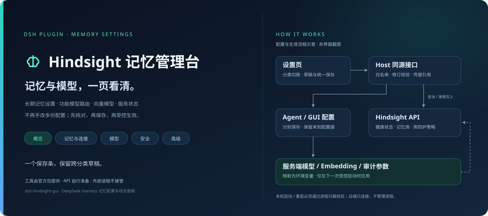
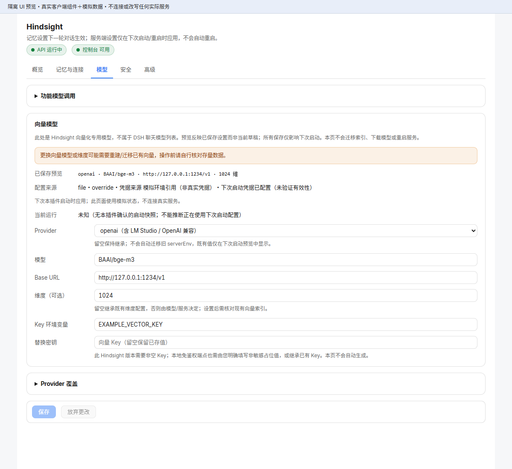
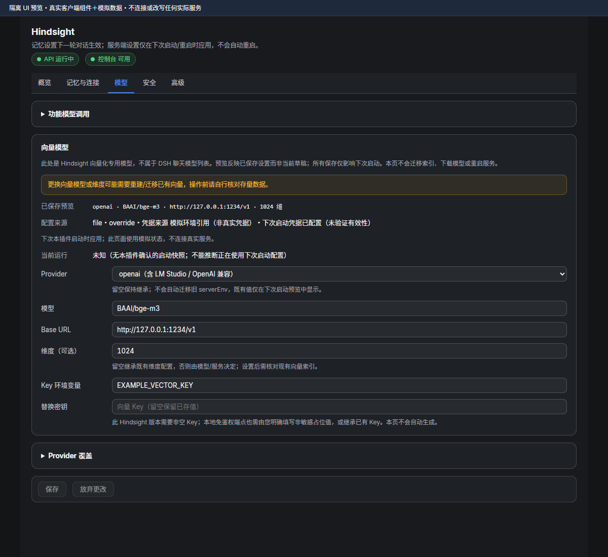
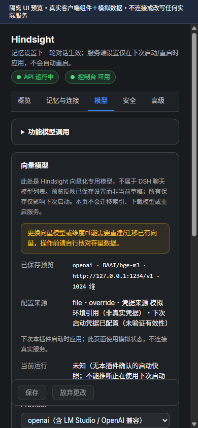

<div align="center">



# Hindsight Settings

**Connection, models and runtime state for your memory stack, in the DeepSeek Harness sidebar.**

`dsh-hindsight-gui` is the configuration and status surface for Hindsight. The memory tools come from the official integration and are not implemented here.

A settings dashboard for Hindsight in DeepSeek Harness—not a memory engine.

[](https://www.npmjs.com/package/dsh-hindsight-gui)
[](https://github.com/KouzakiUmi/dsh-hindsight-gui/actions/workflows/publish.yml)
[](LICENSE)

[Quick start](#quick-start) · [What it shows](#five-sections-one-place) · [Capabilities and limits](#capabilities-and-safety-limits) · [Technical reference](https://github.com/KouzakiUmi/dsh-hindsight-gui/blob/main/docs/technical-reference.md) · [中文说明](https://github.com/KouzakiUmi/dsh-hindsight-gui/blob/main/README.md)

</div>

## Why it exists

| The problem | What this page does |
| --- | --- |
| Checking whether the service is healthy and the console is reachable means switching between windows | One page shows API, Control Plane, database and memory bank status per section |
| Connection address, bank naming and purpose-specific models are scattered across configuration | Edit them by section and submit from a single save bar; drafts survive section switches |
| After changing the embedding backend it is hard to tell "saved" from "running" | Separates the **saved preview for the next start** from the **running snapshot this plugin confirmed** |
| You want to adjust the service without disturbing someone else's process | Start and restart stay available, but restart only targets a service this plugin verified through its process chain or ownership receipt |

## Five sections, one place

**Overview** shows service state, ownership and the launch preview; **Memory & connection** manages the API address and the bank; **Models** configures chat and service models plus the embedding backend; **Security** lists memory banks and sets audit plus per-bank redaction; **Advanced** holds the remaining options. The five ARIA tabs respond to arrow keys, `Home` and `End`; unsaved drafts survive section switches, and polling never overwrites your input.



<sub>Light theme. The screenshots were captured from the Chinese UI; the English layout is identical apart from the strings. Real React 18 components rendered in an isolated page with simulated HTTP data — not a production DSH or Hindsight service.</sub>

<details>
<summary>Dark theme</summary>



</details>

<details>
<summary>Narrow layout</summary>



</details>

### Embedding configuration follows the backend

| Backend | What this page sets | What you provide |
| --- | --- | --- |
| `local` | Model and whether to force CPU | Local dependencies and model files |
| `openai` | OpenAI-compatible model, Base URL, optional dimensions, credential reference or key | A working endpoint; a non-empty key or an inheritable server-side LLM key — local endpoints without auth still need an explicit placeholder |
| `onnx` | Model id and optional dimensions | Local dependencies and model files |
| `tei` | Remote service address | A TEI service; the model and dimensions come from it |

Leaving the backend unset means inheriting the existing service configuration. For `openai` and `onnx`, an empty dimension field **inherits the existing dimensions first**; only when none exist does the backend, model or service decide. Switching backends never migrates the index automatically — check the stored vectors before changing anything. `serverEnv` is an advanced file-level passthrough and **not an editable control on this page**. Field-level details and credential resolution live in the [technical reference](https://github.com/KouzakiUmi/dsh-hindsight-gui/blob/main/docs/technical-reference.md).

### Four states between editing and applying

1. **Editing**: typing stays in a draft while you move between the five sections; base configuration uses the bottom save bar, while the newer management cards run their own save and confirmation flows.
2. **Saved**: two configuration files are written field by field. `apiUrl`, `surveyModel` and the like go to the upstream `coding-agent.json`; service models, embedding settings and the console address live in this plugin's `dsh-hindsight-gui.json`.
3. **Next-start preview**: the embedding card resolves backend, model, dimensions, config and credential source from the saved values. It is **not the current draft**, and it does not prove an external service adopted those values.
4. **Running snapshot**: only a service this plugin started and verified has a snapshot. A healthy external service does not reveal its internal configuration.

Save failures, configuration read failures, 409 conflicts and invalid dimensions are reported explicitly. The two files are saved individually, not as one transaction; when a partial-save notice appears, refresh and verify instead of assuming the other file was written.

### Connecting versus managing locally

| Target | Status | Local start / restart |
| --- | --- | --- |
| An existing Hindsight API | Connection and health queries | A third-party process can never be taken over or stopped here |
| A local API started by this plugin | Supported | Restart only when both the process identity and the target verify |
| Remote, HTTPS, IPv6 or non-root-path URLs | Connect and query; bank policy writes still need target validation and upstream permission | No local process management |

**Start service** looks for an installed `hindsight-api` and its Python; **Restart service** preflights first, then shuts down a verified plugin-owned service through the in-process control extension. Local management currently targets **Hindsight 0.10.2 with a single worker**, and never overwrites an existing HTTP extension. An interpreter chosen on this page wins; otherwise only the interpreter next to the entry point is tried. Non-venv installs, or a missing interpreter beside the entry point, require an explicit interpreter with that Hindsight version — nothing is guessed. A healthy API is not a ready control channel: when the control handshake fails, the page shows a separate error and disables restart. Old instances without the new control channel still only get a non-forced stop attempt; if that fails, close them manually once and start them with the new plugin. Releases never migrate or restart them. This is a settings page, not a deployer: it does not download models, rebuild vector indexes or enable `trust_remote_code`.

## Quick start

1. **Prepare the service**: deploy a reachable API following the [official Hindsight documentation](https://hindsight.vectorize.io/); if you want the local start button, install the `hindsight-api` executable yourself. This plugin neither installs nor deploys services or models.
2. **Install the two packages with different jobs**: the official `@vectorize-io/hindsight-coding-agents` provides the `hindsight_*` tools and the MCP server; `dsh-hindsight-gui` provides the settings page. If you only need memory features, the GUI is not a dependency of the official integration.

```console
dsh plugin --profile web add @vectorize-io/hindsight-coding-agents
dsh plugin --profile web add dsh-hindsight-gui
```

`web` here is **only an example profile**. Verify the actual target and CLI entry point first; Desktop must use the DSH Desktop CLI shipped with that shell rather than a standalone public/Core CLI. Installing is not enabling: check the bundle list and reload or restart the Host and Client for your deployment. Never run npm/pnpm directly inside a profile.

3. **Open the Hindsight page in the sidebar**: enter the Hindsight **API address** (for example `http://127.0.0.1:8888`); Control Plane is the optional management UI (default `http://127.0.0.1:9999`). Save, then check health and the bank list. Installation targets, service versions and available features must be verified against your own environment.

## Language

The settings page and the management panel ship in Chinese and English. A selector in the page header switches immediately and remembers the choice in `localStorage` (`dsh-hindsight-gui.locale`). Without a stored choice the browser decides: any `zh*` locale stays Chinese, everything else starts in English.

Every string in the interface resolves through `src/client/i18n.js` against the catalogue in `src/client/locales/en.js`. Text returned by the host plugin (`lib/`) is displayed as sent, so diagnostics that the server itself produces still appear in Chinese until the host layer is localized — that is a separate follow-up.

## Management

- **Diagnostics and authentication**: liveness, readiness, API version and deployment feature flags are shown separately. API tokens stay inside the Host and support inherit, no-auth and environment/DSH credential references. A reference is bound to the current instance and cannot be forwarded to another.
- **Operation queue**: paged by status and type, with progress and bounded failure summaries; retry, cancel and delete ask first and never replay an ambiguous outcome.
- **Bank settings**: edit missions, retain policies, entity labels, budgets, disposition and retrieval toggles; inheritance and overrides are distinguished, and concurrency is checked by revision. A full reset clears every override, including policies and Memory Defense that the page does not show.
- **Privacy and cost**: global or DSH-scoped auto-inject, session retention, Git ingest, seeding, opt-in paths, survey budget and knowledge page refresh; only changed fields are submitted, and returning to inherit removes the file key instead of writing null.
- **Model debugging**: prompt composition previews without calling the LLM; dry-run extraction and LLM health checks state their cost and only open when the deployment exposes the capability. Codebase survey uses an external CLI model id and does not reuse the DSH model catalogue.
- **ZIP migration and aliases**: asynchronous export, restore/merge import, cloning and alias management. 202 only means submitted, and the record lives in the source or URL bank. restore needs an existing record bank and a target that does not exist yet; this page never creates the record bank. Uploads are capped at 50MiB and the download proxy at 500MiB, and same-origin downloads never forward cross-origin signed URLs.

Writes, charged calls, backups and downloads share one confirmation dialog: type the target, acknowledge the risk and cost checks, and the Host then validates a two-minute one-use token bound to the API, resource and parameters, plus same-origin and actual API capability. The action is disabled when the capability is off or unknown. The global default LLM is independent from reflect; legacy reflect-only configuration keeps the compatible global default and detaches once a default is saved explicitly.

## Capabilities and safety limits

- **Not a memory engine**: this plugin provides no `hindsight_*` tools and deploys no Hindsight. Alongside the official integration it owns configuration and status; memory reads and writes belong to the official package and the Hindsight service.
- **Saving is not applying**: the official 0.8.1 DSH adapter caches workspace configuration, so whether a save took effect is unconfirmed and existing workspaces may need a DSH restart to reinitialize. After disabling memory you still have to verify that recall and write-back actually stopped; opening a new session or restarting the API alone does not guarantee the adapter cache is cleared. Server-side models, embedding configuration and audit only apply on the next **controlled start/restart**; saving never restarts the service by itself. The manual start and restart buttons remain, gated by ownership and preflight. Remote, HTTPS, IPv6 and non-root-path services can be connected but are not managed as local processes — which does not make their bank configuration API read-only.
- **Never kills an arbitrary PID**: only a service verified through its launch process chain or a persistent ownership receipt is stopped, after checking PID, start time and executable path. Separate launcher and listener PIDs on Windows and re-verification after a DSH restart are supported. Port occupancy grants no kill right, and a still-running old DSH is never taken over. On Windows only non-forced stops are attempted, and failures need manual handling rather than a forced kill. Legacy services without an ownership receipt are not adopted automatically, and the real running configuration of an external instance stays unknown.
- **Credentials and data boundaries**: credentials are never echoed in previews, but configuration files are not encrypted vaults; clearing this page's key does not guarantee that inherited environment keys disappear. Per-bank redaction cannot clean third-party logs or historical backups. Saving uses a key allowlist, revision conflict checks and per-file atomic writes; the two files are **not one transaction**.

## Tests and compatibility

The project ships offline Host and Client regressions plus front/back contract tests covering embedding parameter mapping, credential projection, revision conflicts, draft protection and process ownership. The light/dark, narrow and keyboard layouts are verified in isolation with real React components and simulated HTTP data, including an English-mode pass that walks every section and fails on any untranslated string.

These tests do not replace acceptance in your deployment. Verify the export contracts of your DSH Core, the Hindsight service version and the dependencies of the chosen embedding backend; development and validation details are in the [technical reference](https://github.com/KouzakiUmi/dsh-hindsight-gui/blob/main/docs/technical-reference.md).

### Status does not match expectations?

- "API not running": check the API address and the service's own health endpoint first; an unreachable Control Plane does not mean the memory API is down.
- "Applies on next start": this means the saved values differ from the confirmed launch snapshot; for third-party instances this plugin cannot confirm the running configuration.
- "Dimensions unknown": do not guess; confirm the existing index and backend model first, since an empty value may keep inheriting the old configuration.
- "Cannot restart": check whether the process chain or ownership receipt verifies and whether the control channel is ready; a service merely holding the port grants no kill right.

## Learn more

| Document | Contents |
| --- | --- |
| [Technical reference](https://github.com/KouzakiUmi/dsh-hindsight-gui/blob/main/docs/technical-reference.md) | Configuration fields, write boundaries, service management, development and release |
| [Source: Host](https://github.com/KouzakiUmi/dsh-hindsight-gui/blob/main/lib/index.js) / [Client](https://github.com/KouzakiUmi/dsh-hindsight-gui/blob/main/src/client/index.tsx) | The actual interface and UI implementation; [client.js](https://github.com/KouzakiUmi/dsh-hindsight-gui/blob/main/lib/client.js) is the build output |
| [Official Hindsight](https://github.com/vectorize-io/hindsight) | The upstream memory system and deployment notes |

[MIT License](LICENSE) · [Report an issue](https://github.com/KouzakiUmi/dsh-hindsight-gui/issues)
